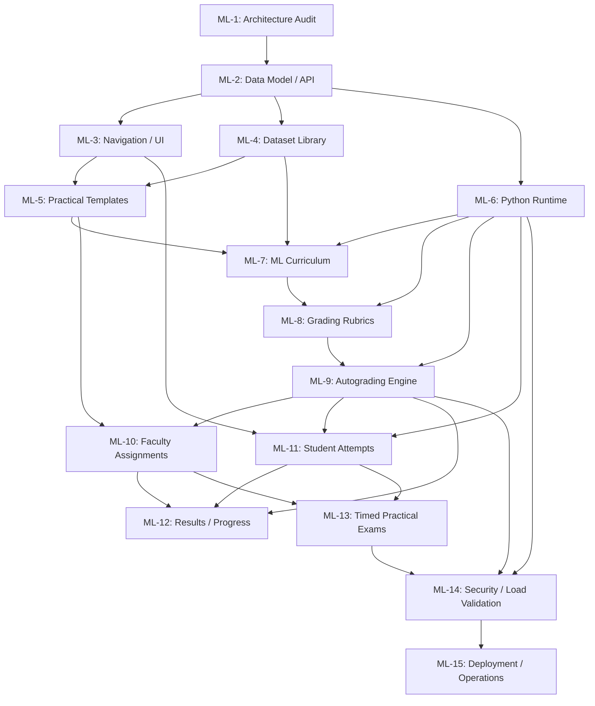

# CODEFROG Module 2 — ML Practical Lab
## Complete 15-Phase Implementation Roadmap (`ML-MODULE-ROADMAP.md`)

- **Current Branch:** `feature/module-2-foundation`
- **Target Repository:** [https://github.com/Ary3126/Secureexamplatform](https://github.com/Ary3126/Secureexamplatform)
- **Status:** Strategic Roadmap & Implementation Blueprint (Pre-Implementation / Non-Destructive)
- **Supporting Context:** [ML-1-ARCHITECTURE-AUDIT.md](file:///c:/ary/SecureExamPlatform/docs/module-2/ML-1-ARCHITECTURE-AUDIT.md)

---

## 1. Architectural Baseline: Verified Repository Facts vs. Proposed Decisions

To ensure engineering safety and backwards compatibility, this roadmap strictly distinguishes between empirical repository findings and proposed Module 2 design decisions.

### 1.1 Verified Repository Facts (`[VERIFIED FACT]`)
1. **Database Schema & Enums (`backend/src/database/schema.sql`):**
   - The user role constraint strictly enforces: `CHECK (role IN ('student', 'professor', 'contest_admin', 'super_admin'))`.
   - **Key Finding:** There is **no** `'faculty'` role string in PostgreSQL. The instructor role is `'professor'`. Module 2 must strictly target `'professor'` for instructor capabilities.
   - Competitive programming ratings reside on `users.current_rating`, `users.highest_rating`, `users.rated_contest_count`, and table `rating_history`.
2. **Authentication & Authorization Pipeline (`backend/src/middleware/`):**
   - `authMiddleware.js` verifies JWT tokens, checks integer `userId > 0`, verifies `is_active === true`, and attaches the sanitized user object to `req.user`.
   - `roleMiddleware.js` uses `authorizeRoles(...allowedRoles)`. Denied attempts log security audit records to `audit_logs` via `AuditLogger.logAction` with action `'PRIVILEGED_ACTION_DENIED'`.
3. **HTTP Server & Routing Guardrails (`backend/src/server.js`, `backend/src/routes/index.js`):**
   - Express server enforces Helmet CSP, CORS policies, standard request ID tracing (`requestIdMiddleware`), metrics recording, HPP defense, and 512 KB JSON body limits.
   - All REST APIs are mounted under `/api`. Standard error response contract: `{ status: "error", statusCode, error, message, requestId, timestamp }`.
4. **Existing Execution Pipeline (`backend/src/judge/`):**
   - Built for competitive programming: low latency (<2-5 seconds), tight memory limits (<256-512 MB), and standard I/O (stdin/stdout).
   - `JudgeQueue` runs with a default in-process concurrency of 2 jobs and a maximum queue limit of 500 jobs.
   - `DockerRunner` executes with `--network none --cap-drop ALL --security-opt no-new-privileges --memory 512m --cpus 1.0`, falling back to native execution if the Docker daemon is unreachable.
5. **Frontend Architecture (`frontend/src/`):**
   - Built with React 19 and Vite 8.
   - Routing is controlled via `activeView` state in `App.jsx` and synchronized with browser history via `window.history.pushState`.
   - Sidebar navigation is driven by declarative groups in `navConfig.js` filtered by `item.allowedRoles`. Quick navigation is enabled via `CommandPalette.jsx`.
   - Styling is powered by custom Vanilla CSS design tokens in `index.css`.
6. **Testing Architecture:**
   - Unified test runner located at `backend/scripts/testRunner.js`, executable via `node scripts/testRunner.js --category=all`.

### 1.2 Proposed Architectural Decisions (`[PROPOSED DECISION]`)
1. **Isolated Database Domain (`ml_*` Tables):**
   - All Module 2 persistent data will reside in isolated tables prefixed with `ml_`: `ml_datasets`, `ml_practicals`, `ml_practical_datasets`, `ml_attempts`, `ml_grades`, `ml_assignments`, `ml_assignment_enrollments`, and `ml_exam_sessions`.
   - Zero modifications to Module 1 tables (`users`, `contests`, `problems`, `submissions`, `rating_history`).
2. **Execution Decoupling:**
   - ML training and evaluation tasks require long runtimes (30s to 5 minutes), large scientific libraries (NumPy, Pandas, Scikit-Learn, PyTorch), and heavy datasets (10 MB to 500 MB).
   - Under no circumstances will Python ML code run inside the Node.js Express process or inside the lightweight Module 1 CP judge queue.
   - Execution will be handled by a dedicated asynchronous worker reading from an isolated transactional job table, executing containers with resource-capped cgroups and complete network isolation (`--network none`).
3. **Infrastructure Prudence (Deferral of Heavy Frameworks):**
   - Complex orchestration platforms like JupyterHub, DockerSpawner, and Kubernetes operators are **deferred**. A headless, asynchronous Docker worker executing structured Python scripts meets all pedagogical and evaluation requirements without prohibitive operational complexity.
4. **Monaco Python IDE & Dataset Drawer:**
   - The student workspace will utilize the existing `@monaco-editor/react` configured for Python, paired with an interactive execution console, dataset schema drawer, and real-time metric scorecard. Full multi-cell notebook kernels are deferred until post-MVP.

---

## 2. Universal Cross-Phase Engineering Rules

The following six mandatory cross-phase rules govern all Module 2 development across every phase. No phase may violate or bypass these rules.

```
┌────────────────────────────────────────────────────────────────────────┐
│               UNIVERSAL CROSS-PHASE ENGINEERING RULES                  │
├────────────────────────────────────────────────────────────────────────┤
│ 1. Feature Flags              │ Fail-closed backend & frontend gating  │
│ 2. Versioned Published Content│ Immutability of live evaluation specs  │
│ 3. Hidden-Test Isolation      │ Zero student access to evaluation data │
│ 4. No Python in Express       │ Strict async worker sandbox boundary   │
│ 5. Module 1 Regression Testing│ 100% pass on existing test suites      │
│ 6. Evidence-Based Completion  │ Verification artifacts & test evidence │
└────────────────────────────────────────────────────────────────────────┘
```

### Rule 1: Feature Flag Gating & Fail-Closed Isolation
- **Backend Flag:** `ENABLE_MODULE_2_ML=true|false` (in `backend/src/config/env.js`).
- **Frontend Flag:** `VITE_ENABLE_MODULE_2_ML=true|false` (in `frontend/src/config/featureFlags.js`).
- **Fail-Closed Contract:** When disabled, all endpoints under `/api/ml/*` must immediately respond with HTTP 503 `FEATURE_DISABLED` or HTTP 404. All navigation items and command palette actions must be completely hidden. Background ML workers must refuse to pick up jobs.
- **Independence:** Disabling the flag must leave all Module 1 examination, contest, problem explorer, submission, and rating features completely intact.

### Rule 2: Versioned Published Content
- Once an ML practical, assignment, or rubric is set to `status = 'published'`, its core evaluation criteria, dataset associations, and target metric thresholds become strictly immutable.
- Any subsequent modifications by faculty create a new draft revision or require explicit versioning (`version_major`, `version_minor`).
- Student attempts are indelibly linked to the exact practical version snapshot active at the time of submission. This guarantees historical grading reproducibility and eliminates grading drift.

### Rule 3: Hidden-Test & Evaluation Dataset Isolation
- Datasets designated as `access_type = 'hidden_eval'` or `dataset_role = 'hidden_test'` must **never** be exposed via public or student REST endpoints.
- Student workspace containers must **never** have read access to hidden test files or ground-truth label columns during the student script runtime.
- The evaluation harness executes in a shielded supervisor phase after student code execution completes or inside a locked evaluation runner where student code only exports a prediction model/function.
- Evaluation datasets must be stored outside the web root and guarded by strict role-based access checks (`'professor'` and `'super_admin'` only).

### Rule 4: No Python Execution Inside Express
- Untrusted Python code must **never** be spawned via `child_process.exec`, `child_process.spawn`, or worker threads within the Express API process.
- All Python execution must be offloaded asynchronously to isolated, containerized workers running with `--network none`, `--cap-drop ALL`, `--security-opt no-new-privileges`, and strict memory/CPU limits.
- The Express API only validates inputs, persists queued job records in PostgreSQL, and serves polling verdicts.

### Rule 5: Module 1 Zero-Regression Testing
- At every phase boundary, the complete Module 1 regression suite (`node scripts/testRunner.js --category=all`) and frontend test suite must pass with 100% success.
- Module 1 competitive programming ratings (`users.current_rating`, `users.highest_rating`, `rating_history`) are strictly immutable by Module 2 actions.
- The CP judge queue and database performance must exhibit zero latency degradation during ML lab operations.

### Rule 6: Evidence-Based Phase Completion
- No phase can be marked complete through manual assertion or assumption.
- Completion requires verifiable evidence:
  1. Automated test runs with clean zero-failure exit codes.
  2. Recorded stdout/stderr test runner output stored in test documentation.
  3. Database migration idempotent verification.
  4. RBAC and BOLA security boundary test results.

---

## 3. The 15-Phase Module 2 Roadmap

```
Phase 1  ──► Phase 2  ──► Phase 3  ──► Phase 4  ──► Phase 5
(Audit)     (Data API)    (Nav/UI)    (Datasets)   (Templates)
                                                        │
Phase 10 ◄── Phase 9  ◄── Phase 8  ◄── Phase 7  ◄── Phase 6
(Assign)    (Autograde)   (Rubrics)   (Curric)     (Python RT)
   │
   ▼
Phase 11 ──► Phase 12 ──► Phase 13 ──► Phase 14 ──► Phase 15
(Attempts)  (Progress)    (Exams)     (Security)   (Deploy Ops)
```

---

### Phase ML-1: Architecture Audit & Foundation Blueprint

- **Goal:** Perform a comprehensive audit of the existing CODEFROG repository, identify architectural delta between competitive programming and machine learning workloads, establish non-destructive integration boundaries, and produce foundational documentation.
- **Tasks:**
  - Audit database schema, connection pools, and migration mechanics (`schema.sql`, `initDb.js`, `db.js`).
  - Document role discrepancy (`'professor'` in database vs `'faculty'` in common nomenclature).
  - Inspect authentication, RBAC, rate limiting, and audit logging middleware.
  - Review existing code judge execution pipeline (`judgeQueue.js`, `DockerRunner.js`, `PythonRunner.js`) and document why ML workloads require separate infrastructure.
  - Evaluate heavy orchestration frameworks (JupyterHub, DockerSpawner) and document technical rationale for deferring them.
  - Define feature flag gating strategy and isolation boundaries.
  - Author comprehensive architectural audit and complete 15-phase implementation roadmap.
- **Dependencies:** None (operates on existing Module 1 codebase).
- **Deliverables:**
  - `docs/module-2/ML-1-ARCHITECTURE-AUDIT.md` (Architecture Audit & Blueprint).
  - `docs/module-2/ML-MODULE-ROADMAP.md` (Complete 15-Phase Roadmap).
- **Security Considerations:**
  - Ensure zero modification to existing codebase or database during audit phase.
  - Document fail-closed security boundary for untrusted code execution.
  - Verify that audit logging (`audit_logs`) covers all privileged access attempts.
- **Acceptance Criteria:**
  - Complete architecture audit document detailing all verified repository findings vs proposed decisions.
  - 15-phase roadmap covering all deliverables, security rules, and test requirements.
  - Zero application code, database, or dependency modifications committed.
- **Tests:**
  - Execute existing Module 1 test suite to establish clean baseline: `node scripts/testRunner.js --category=all`.
  - Validate that git status confirms only documentation files are modified.

---

### Phase ML-2: Data Model & API Foundation

- **Goal:** Establish the foundational PostgreSQL data models, migration scripts, feature flag middleware, and base routing infrastructure for Module 2.
- **Tasks:**
  - Create idempotent SQL migration script `backend/src/database/migrations/ml_module_schema.sql` defining:
    - `ml_datasets`
    - `ml_practicals`
    - `ml_practical_datasets`
    - `ml_attempts`
    - `ml_grades`
  - Integrate migration conditionally into `backend/src/config/initDb.js` guarded by `ENABLE_MODULE_2_ML`.
  - Implement parameterized model classes in `backend/src/models/`:
    - `mlDatasetModel.js`
    - `mlPracticalModel.js`
    - `mlAttemptModel.js`
    - `mlGradeModel.js`
  - Build feature flag guard middleware `backend/src/middleware/mlFeatureGuard.js`.
  - Create status controller and endpoint: `GET /api/ml/status`.
  - Mount `/api/ml` router in `backend/src/routes/index.js` behind the feature guard.
- **Dependencies:** Phase ML-1.
- **Deliverables:**
  - `backend/src/database/migrations/ml_module_schema.sql`
  - Updated `backend/src/config/initDb.js`
  - `backend/src/middleware/mlFeatureGuard.js`
  - `backend/src/models/mlDatasetModel.js`, `mlPracticalModel.js`, `mlAttemptModel.js`, `mlGradeModel.js`
  - `backend/src/controllers/mlStatusController.js`
  - `backend/src/routes/mlRoutes.js`
  - Test suite: `backend/test_phase_ml_2_data_model.js`
- **Security Considerations:**
  - All database queries must use parameterized placeholders (`$1, $2, ...`).
  - Feature flag must fail closed (return HTTP 503 `FEATURE_DISABLED` when inactive).
  - Explicit database foreign keys referencing `users(id)` with `ON DELETE RESTRICT` or `CASCADE`.
  - Strict rating invariant: zero schema modifications or triggers touching `users.current_rating` or `rating_history`.
- **Acceptance Criteria:**
  - Migration script runs idempotently with zero errors.
  - When `ENABLE_MODULE_2_ML=false`, `GET /api/ml/status` returns HTTP 503.
  - When `ENABLE_MODULE_2_ML=true`, `GET /api/ml/status` returns HTTP 200 with runtime capabilities.
  - Models execute CRUD operations cleanly without affecting existing tables.
- **Tests:**
  - Feature flag toggle test (verifying 503 vs 200 response).
  - Idempotent migration rerun test.
  - Model unit test suite covering insert, query, update, and soft delete.
  - Module 1 regression suite pass.

---

### Phase ML-3: Navigation & UI Shell Integration

- **Goal:** Integrate Module 2 seamlessly into the React frontend navigation, client-side routing, and command palette, safely gated by frontend feature flags and user roles.
- **Tasks:**
  - Define `VITE_ENABLE_MODULE_2_ML` in `frontend/src/config/featureFlags.js` and `.env.example`.
  - Update `frontend/src/config/navConfig.js` to add:
    - `"ML Practical Lab"` under `'main'` group (`view: 'ml_lab'`, `allowedRoles: null`).
    - `"ML Lab Studio"` under `'faculty'` group (`view: 'ml_authoring'`, `allowedRoles: ['professor', 'super_admin']`).
  - Update `frontend/src/App.jsx` client-side view router to register routes:
    - `/ml` and `/ml/practicals` -> `'ml_lab'` view.
    - `/ml/practicals/:id` -> `'ml_workspace'` view.
    - `/ml/studio` -> `'ml_authoring'` view.
  - Update `frontend/src/components/navigation/CommandPalette.jsx` to register Module 2 search actions.
  - Create placeholder UI shells in `frontend/src/components/ml/`:
    - `MlPracticalExplorer.jsx`
    - `MlWorkspaceShell.jsx`
    - `MlAuthoringStudioShell.jsx`
  - Implement graceful fallback redirect if a user navigates to `/ml` when the flag is disabled.
- **Dependencies:** Phase ML-1, Phase ML-2.
- **Deliverables:**
  - Updated `frontend/src/config/navConfig.js`
  - Updated `frontend/src/App.jsx`
  - Updated `frontend/src/components/navigation/CommandPalette.jsx`
  - Shell components: `MlPracticalExplorer.jsx`, `MlWorkspaceShell.jsx`, `MlAuthoringStudioShell.jsx`
  - Test suite: `frontend/src/tests/ml_navigation.test.jsx`
- **Security Considerations:**
  - Client-side navigation visibility must strictly mirror server-side RBAC.
  - Faculty Studio links must never render for `'student'` accounts.
  - Direct URL access to `/ml` when flag is disabled must redirect safely without leaking internal states.
- **Acceptance Criteria:**
  - When `VITE_ENABLE_MODULE_2_ML=false`, zero ML navigation items appear in sidebar or command palette.
  - When enabled, students see "ML Practical Lab", professors see both "ML Practical Lab" and "ML Lab Studio".
  - Routing handles URL transitions cleanly, matching the existing Vanilla CSS theme and dark/light tokens.
- **Tests:**
  - Component unit tests asserting role-based navigation item rendering.
  - Route navigation and fallback redirection tests.
  - Command palette action availability tests.
  - Module 1 frontend test suite pass.

---

### Phase ML-4: Dataset Library & Storage Management

- **Goal:** Implement secure file storage, integrity validation, metadata extraction, and access control for machine learning datasets (training, hidden evaluation, and sample sets).
- **Tasks:**
  - Create dataset storage abstraction service `backend/src/services/datasetStorageService.js` with local disk storage provider and future S3/MinIO pluggable interface.
  - Implement SHA-256 checksum calculation and file size verification on upload.
  - Implement schema metadata extractor for tabular formats (CSV, Parquet) extracting column names, data types, sample rows, and row counts.
  - Build dataset controllers and routes:
    - `POST /api/ml/datasets` (Faculty/Admin dataset upload).
    - `GET /api/ml/datasets` (List datasets filtered by role and permissions).
    - `GET /api/ml/datasets/:id` (Inspect dataset schema metadata).
    - `GET /api/ml/datasets/:id/download` (Download training/sample datasets).
  - Enforce strict download protection: `access_type = 'hidden_eval'` must strictly reject student download requests.
  - Implement path traversal protection and secure filename sanitization.
- **Dependencies:** Phase ML-2.
- **Deliverables:**
  - `backend/src/services/datasetStorageService.js`
  - `backend/src/utils/datasetMetadataExtractor.js`
  - `backend/src/controllers/mlDatasetController.js`
  - Dataset API routes in `backend/src/routes/mlRoutes.js`
  - Storage directory setup: `backend/storage/datasets/` (git-ignored)
  - Test suite: `backend/test_phase_ml_4_dataset_library.js`
- **Security Considerations:**
  - Defense against path traversal (`path.resolve`, `path.basename`, jail root enforcement).
  - Maximum upload size enforcement (e.g., 100 MB).
  - MIME type and magic number validation (reject executable binaries).
  - Hidden evaluation datasets (`access_type = 'hidden_eval'`) must return HTTP 403 `FORBIDDEN` for `'student'` role.
- **Acceptance Criteria:**
  - Professors can upload CSV/Parquet datasets, generating SHA-256 and metadata automatically.
  - Students can download `public_train` and `sample` datasets.
  - Students attempting to download `hidden_eval` datasets are blocked with HTTP 403 and logged to `audit_logs`.
  - Path traversal exploits (`../../etc/passwd`) are thwarted and logged as security incidents.
- **Tests:**
  - Dataset upload and checksum validation test.
  - Metadata extraction test on sample CSV and Parquet files.
  - BOLA / RBAC test verifying student blocked from hidden dataset download.
  - Path traversal attack penetration test.

---

### Phase ML-5: Practical Templates & Authoring Studio

- **Goal:** Enable faculty (`'professor'`) to author, configure, draft, and publish ML practical assignments with starter code, datasets, evaluation metrics, and rubric weightings.
- **Tasks:**
  - Author practical management controllers:
    - `POST /api/ml/practicals` (Create draft practical).
    - `PUT /api/ml/practicals/:id` (Update practical metadata, starter code, limits).
    - `POST /api/ml/practicals/:id/datasets` (Associate datasets with roles: `train`, `hidden_test`, `sample_validation`).
    - `POST /api/ml/practicals/:id/publish` (Publish practical, making it immutable and active).
    - `GET /api/ml/practicals` (Catalog browse with track and difficulty filters).
    - `GET /api/ml/practicals/:id` (Detailed instructions and starter code).
  - Implement practical input validation:
    - Time limits: 10s to 600s.
    - Memory limits: 512 MB to 8192 MB.
    - Metric validation (`accuracy`, `f1_score`, `rmse`, `mae`, `auc_roc`).
    - Rubric validation (`metrics_weight + code_quality_weight === 1.0`).
  - Provide built-in assignment template presets (Linear Regression, Binary Classification, Sentiment Analysis).
  - Build frontend `MlAuthoringStudio.jsx` with code template editor, dataset selector, rubric sliders, and preview panel.
- **Dependencies:** Phase ML-2, Phase ML-3, Phase ML-4.
- **Deliverables:**
  - `backend/src/controllers/mlPracticalController.js`
  - `backend/src/validators/mlPracticalValidator.js`
  - Updated routes in `backend/src/routes/mlRoutes.js`
  - Frontend component: `frontend/src/components/ml/MlAuthoringStudio.jsx`
  - Test suite: `backend/test_phase_ml_5_practical_authoring.js`
- **Security Considerations:**
  - BOLA protection: Professors can only edit their own practicals unless they hold `super_admin`.
  - Students attempting to call authoring endpoints must receive HTTP 403 `AUTHORIZATION_ERROR`.
  - Sanitization of Markdown instructions and problem descriptions to prevent stored XSS.
  - Hidden evaluation datasets must never be leaked in `GET /api/ml/practicals/:id` response payloads.
- **Acceptance Criteria:**
  - Professors can create, edit, and publish practicals.
  - Published practicals transition to immutable state; students cannot view draft practicals.
  - API correctly separates public training datasets from hidden test datasets in response payloads.
- **Tests:**
  - Authoring RBAC and BOLA ownership verification tests.
  - Input validation bounds tests (limits, weights, metrics).
  - Lifecycle state machine tests (`draft` -> `published` -> `archived`).
  - Hidden dataset payload scrubbing test.

---

### Phase ML-6: Python Runtime & Isolated Execution Worker

- **Goal:** Build an asynchronous, containerized execution worker capable of executing student Python code with data science libraries (NumPy, Pandas, Scikit-Learn, PyTorch) under strict hardware caps, complete network disconnection, and zero impact on the Express server.
- **Tasks:**
  - Author Dockerfile for ML runner container (`docker/Dockerfile.ml-sandbox`):
    - Base: Python 3.11 slim.
    - Pinned packages: `numpy`, `pandas`, `scipy`, `scikit-learn`, `torch` (CPU), `joblib`.
    - Non-privileged execution user (`sandbox_user`, UID 10001).
  - Implement `backend/src/judge/mlDockerRunner.js`:
    - Flags: `--network none --cap-drop ALL --security-opt no-new-privileges --read-only`.
    - Hard cgroup ceilings: `--memory`, `--cpus`, `--pids-limit 100`.
    - Mount temporary student workspace in `/tmp` (ephemeral tmpfs) and read-only dataset paths.
  - Implement standalone worker service `backend/src/workers/mlExecutionWorker.js`:
    - Polls or listens to queued rows in `ml_attempts`.
    - Concurrency limited by `ML_WORKER_CONCURRENCY` (default: 2).
    - Captures execution time, peak memory usage, exit code, stdout, and sanitized stderr.
    - Updates attempt status to `running`, `completed`, `timeout`, `oom`, or `failed`.
- **Dependencies:** Phase ML-1, Phase ML-2.
- **Deliverables:**
  - `docker/Dockerfile.ml-sandbox` and `docker/requirements-ml.txt`
  - `backend/src/judge/mlDockerRunner.js`
  - `backend/src/workers/mlExecutionWorker.js`
  - Process supervisor config / npm script: `npm run worker:ml`
  - Test suite: `backend/test_phase_ml_6_execution_worker.js`
- **Security Considerations:**
  - Absolute network isolation (`--network none`) prevents data exfiltration, socket connections, and reverse shells.
  - Read-only root filesystem prevents container compromise or persistent backdoors.
  - Pids limit (`--pids-limit 100`) prevents fork bomb denial-of-service attacks.
  - Zero environment variable leakage: database credentials, JWT secrets, and API keys must **never** be injected into the container.
- **Acceptance Criteria:**
  - Student scripts execute in isolated Docker containers with access to scientific libraries.
  - Long-running scripts are terminated at `time_limit_seconds` with status `timeout`.
  - Memory-hog scripts exceeding `memory_limit_mb` are terminated with status `oom`.
  - The Express API event loop experiences zero CPU/memory degradation during execution.
- **Tests:**
  - Network isolation penetration test (verifying socket connection throws error).
  - Disk write protection test (verifying unauthorized file system writes fail).
  - Fork bomb denial-of-service containment test.
  - Timeout and OOM enforcement tests.

---

### Phase ML-7: ML Curriculum & Starter Practical Bank

- **Goal:** Seed the platform with a production-grade initial curriculum of ML practical assignments covering core data science tracks (Regression, Classification, NLP, Unsupervised Learning) with complete datasets, starter code, and verified reference solutions.
- **Tasks:**
  - Author curriculum database seeder: `backend/src/database/seeds/mlCurriculumSeeds.js`.
  - Curate and package standardized educational datasets:
    - Tabular Regression: Housing Prices (Tabular features, target: price).
    - Tabular Classification: Breast Cancer Diagnostic / Loan Default Prediction.
    - NLP Classification: Customer Review Sentiment (Text, target: positive/negative).
    - Unsupervised Learning: Customer Segmentation (K-Means clustering features).
  - Author starter code skeletons and reference solution scripts for each practical.
  - Package both public training datasets and hidden evaluation datasets for each seed assignment.
  - Create administrative seed command: `node backend/scripts/seedMlCurriculum.js`.
- **Dependencies:** Phase ML-4, Phase ML-5, Phase ML-6.
- **Deliverables:**
  - `backend/src/database/seeds/mlCurriculumSeeds.js`
  - `backend/scripts/seedMlCurriculum.js`
  - Seed dataset archives in `backend/storage/seed_datasets/`
  - Reference solution validation scripts in `backend/tests/fixtures/ml_solutions/`
  - Test suite: `backend/test_phase_ml_7_curriculum_seeds.js`
- **Security Considerations:**
  - Seed scripts must verify database connection and run only in development or authorized setup modes.
  - Hidden evaluation datasets in seed packages must be marked with `access_type = 'hidden_eval'` immediately upon insertion.
  - Starter code must be scrubbed of any hints or solution logic.
- **Acceptance Criteria:**
  - Running seed script loads 4+ comprehensive practical assignments into PostgreSQL.
  - Seeded assignments encompass Easy, Medium, and Hard tiers across Regression, Classification, and NLP tracks.
  - Reference solutions successfully execute and score >= 90% against autograding rubrics.
- **Tests:**
  - Seeder idempotency test (re-running seed does not duplicate rows or crash).
  - Curriculum integrity test verifying that all seeded practicals have valid datasets and rubric configs.
  - Reference solution execution verification across all seeded practicals.

---

### Phase ML-8: Grading Rubrics & Evaluation Adapter

- **Goal:** Develop a modular, tamper-resistant evaluation adapter that computes empirical metrics (Accuracy, F1-Score, ROC-AUC, RMSE, MAE) and multi-dimensional rubrics inside the sandbox without exposing ground-truth labels to student code.
- **Tasks:**
  - Build evaluation adapter framework in Python: `backend/src/judge/harness/eval_harness.py`.
  - Implement metric evaluators:
    - Classification: Accuracy, Precision, Recall, Macro/Micro F1, ROC-AUC.
    - Regression: RMSE, MAE, R-squared ($R^2$), MAPE.
  - Implement multi-dimensional rubric calculation:
    - Empirical Metric Score: Pro-rated score against baseline and target thresholds.
    - Execution Efficiency Score: Penalties for excessive runtime or memory usage.
    - Code Quality / Formatting Score: Static verification (linting, function signature compliance).
  - Structure evaluation output envelope:
    ```json
    {
      "empiricalMetrics": { "rmse": 32150.4, "baseline": 45000.0, "target": 30000.0 },
      "rubricBreakdown": { "metricScore": 65.0, "efficiencyScore": 25.0, "codeScore": 10.0 },
      "finalScore": 100.0,
      "feedback": "Baseline exceeded. Memory within optimal parameters."
    }
    ```
  - Implement anti-tamper mechanisms preventing student code from mocking or monkey-patching evaluation functions.
- **Dependencies:** Phase ML-6, Phase ML-7.
- **Deliverables:**
  - `backend/src/judge/harness/eval_harness.py`
  - `backend/src/judge/harness/metrics.py`
  - `backend/src/judge/harness/rubric_calculator.py`
  - JSON schema validator for evaluation verdicts
  - Test suite: `backend/test_phase_ml_8_evaluation_adapter.js`
- **Security Considerations:**
  - Evaluator harness executes in a distinct phase after student code executes or imports the student script as a module under an isolated security context.
  - Ground-truth evaluation datasets are mounted read-only and never exposed to the student script scope.
  - Overriding `sys.modules`, `eval`, or standard metric functions inside student code must not manipulate rubric calculation.
- **Acceptance Criteria:**
  - Evaluation adapter calculates metrics accurately matching Scikit-Learn standards.
  - Rubric breakdown respects assigned weights (`metrics_weight` vs `code_quality_weight`).
  - Submissions producing NaN, infinite values, or dimension mismatches receive clean failure feedback without crashing the runner.
- **Tests:**
  - Metric mathematical correctness tests across regression and classification fixtures.
  - Anti-tamper verification (attempting to override `metrics.py` from student script).
  - Malformed predictions handling test (shape mismatch, NaN, empty arrays).

---

### Phase ML-9: Autograding Engine & Feedback Pipeline

- **Goal:** Integrate worker execution outputs, metric evaluation, and rubric scores into the persistent grading pipeline (`ml_grades`), providing automated diagnostics and supporting faculty grade overrides.
- **Tasks:**
  - Implement autograding coordinator `backend/src/services/mlAutograderService.js`:
    - Ingests raw worker outputs and evaluation envelopes.
    - Updates `ml_attempts` terminal state (`completed`, `failed`).
    - Inserts academic grade record into `ml_grades`.
    - Generates actionable student feedback notes explaining score deductions.
  - Implement stderr sanitizer removing internal system paths, container hashes, and sensitive server details.
  - Implement faculty grade override endpoint:
    - `POST /api/ml/grades/:id/override` (Updates `final_score`, `feedback_notes`, sets `grader_type = 'faculty_override'`).
    - Logs audit record in `audit_logs` table.
  - Implement student grade inquiry endpoints:
    - `GET /api/ml/attempts/:attemptId` (Student polling for status and score).
    - `GET /api/ml/practicals/:id/grades/my` (Student viewing own grade history).
- **Dependencies:** Phase ML-6, Phase ML-8.
- **Deliverables:**
  - `backend/src/services/mlAutograderService.js`
  - `backend/src/controllers/mlGradeController.js`
  - Stderr sanitization utility: `backend/src/utils/stderrSanitizer.js`
  - Grade override routes in `backend/src/routes/mlRoutes.js`
  - Test suite: `backend/test_phase_ml_9_autograding_pipeline.js`
- **Security Considerations:**
  - BOLA defense: Students can only view their own grades and attempts.
  - Stderr sanitization prevents reconnaissance of container environments or server file paths.
  - Grade overrides strictly restricted to `'professor'` and `'super_admin'` roles.
  - Rating invariant: zero interaction with competitive programming ratings (`users.current_rating`).
- **Acceptance Criteria:**
  - Submitting an attempt triggers background grading, terminating in an `ml_grades` record.
  - Students receive detailed rubric breakdowns and clear feedback notes.
  - Professors can override scores, with full audit trail logging.
- **Tests:**
  - End-to-end autograding pipeline test from submission to persisted grade.
  - Stderr sanitization test (verifying internal paths are scrubbed).
  - BOLA access control test on grade retrieval.
  - Faculty grade override authorization and audit logging test.

---

### Phase ML-10: Faculty Assignment Management & Classroom Workflows

- **Goal:** Enable professors to group practicals into structured course assignments with scheduled availability windows, hard submission deadlines, cohort enrollments, and class roster grading sheets.
- **Tasks:**
  - Create database migration for assignment management:
    - `ml_assignments` (title, practical_id, course_code, start_time, due_date, hard_cutoff, late_penalty_percent).
    - `ml_assignment_enrollments` (assignment_id, user_id, status).
  - Build assignment management controllers:
    - `POST /api/ml/assignments` (Create course assignment).
    - `PUT /api/ml/assignments/:id` (Update deadlines and settings).
    - `GET /api/ml/assignments` (List active assignments for enrolled students or assigned professors).
    - `GET /api/ml/assignments/:id/roster` (Classroom gradebook showing all student submissions and scores).
    - `GET /api/ml/assignments/:id/export` (Export roster grades to CSV).
  - Implement deadline enforcement: reject or apply penalties to submissions received after `due_date`.
  - Build frontend `FacultyAssignmentManager.jsx` view with deadline picker and roster table.
- **Dependencies:** Phase ML-5, Phase ML-9.
- **Deliverables:**
  - Migration script: `backend/src/database/migrations/ml_assignments_schema.sql`
  - `backend/src/models/mlAssignmentModel.js`
  - `backend/src/controllers/mlAssignmentController.js`
  - Frontend component: `frontend/src/components/ml/FacultyAssignmentManager.jsx`
  - Test suite: `backend/test_phase_ml_10_assignments_roster.js`
- **Security Considerations:**
  - Strict cohort authorization: students can only view assignments for classes they are enrolled in.
  - Professors can only view and manage assignments for their own classes.
  - Submissions received after `hard_cutoff` must be rejected with HTTP 400 `DEADLINE_PASSED`.
- **Acceptance Criteria:**
  - Professors can schedule assignments with deadlines and late penalties.
  - Enrolled students see upcoming assignments on their dashboard.
  - Roster view accurately calculates class averages, submission rates, and grade distributions with CSV export.
- **Tests:**
  - Deadline enforcement tests (on-time, late penalty applied, hard cutoff rejected).
  - Enrollment authorization tests (unauthorized student denied access).
  - Grade roster aggregation and CSV export format verification test.

---

### Phase ML-11: Student Attempt Workspace & Interactive Experimentation

- **Goal:** Deliver an intuitive, responsive student workspace supporting in-browser Python code editing, dataset schema inspection, interactive testing (`run`), and formal grading submission (`submit`).
- **Tasks:**
  - Build full student workspace view: `frontend/src/components/ml/MlWorkspace.jsx`.
  - Integrate Monaco Editor configured for Python syntax highlighting, autocompletion, and keyboard shortcuts.
  - Implement dataset drawer `DatasetSchemaDrawer.jsx` showing:
    - Column feature names and inferred types.
    - Sample head rows (5-10 rows).
    - Missing value counts and summary statistics.
  - Implement interactive test execution panel `ConsoleOutput.jsx`:
    - Triggers `POST /api/ml/practicals/:id/run` (interactive test on sample data).
    - Polls attempt status with animated progress indicator.
    - Streams stdout/stderr to a terminal-styled console.
  - Implement formal grading submission workflow:
    - Triggers `POST /api/ml/practicals/:id/submit` (official graded run on hidden evaluation set).
    - Displays detailed rubric scorecard upon completion (`GradeCard.jsx`).
  - Implement local storage auto-save for student code drafts.
- **Dependencies:** Phase ML-3, Phase ML-6, Phase ML-9.
- **Deliverables:**
  - `frontend/src/components/ml/MlWorkspace.jsx`
  - `frontend/src/components/ml/DatasetSchemaDrawer.jsx`
  - `frontend/src/components/ml/ConsoleOutput.jsx`
  - `frontend/src/components/ml/GradeCard.jsx`
  - Test suite: `frontend/src/tests/ml_workspace.test.jsx`
- **Security Considerations:**
  - XSS defense: Terminal console output must escape all ANSI/HTML characters before rendering.
  - Rate limiting: Debounce run/submit buttons on client to prevent accidental rapid submissions.
  - Prevent accidental loss of student work via `beforeunload` warning when unsaved changes exist.
- **Acceptance Criteria:**
  - Monaco editor loads starter code, allows editing, and saves drafts locally.
  - Interactive test runs display stdout and diagnostic logs.
  - Formal submission triggers autograding and displays rubric breakdown.
  - UI adheres to Vanilla CSS design tokens with full dark/light theme support.
- **Tests:**
  - Workspace component rendering and editor initialization test.
  - Run and submit API trigger and polling state machine test.
  - Console output sanitization and XSS prevention test.
  - Auto-save local storage recovery test.

---

### Phase ML-12: Results, Analytics & Progress Tracking

- **Goal:** Deliver comprehensive learning analytics, skill mastery dashboards, and historical attempt timelines for students and faculty.
- **Tasks:**
  - Build analytics database query service: `backend/src/services/mlAnalyticsService.js`:
    - Student track mastery (percentage completed across Regression, Classification, NLP, etc.).
    - Submission attempt frequency and score progression over time.
    - Class-level performance analytics (median score, difficulty distribution, error hotspots).
  - Implement analytics REST endpoints:
    - `GET /api/ml/analytics/student/me` (Student own learning metrics).
    - `GET /api/ml/analytics/practicals/:id` (Faculty overview of practical difficulty & score curve).
    - `GET /api/ml/analytics/courses/:courseCode` (Course cohort performance summary).
  - Build frontend student dashboard view: `frontend/src/components/ml/MlStudentDashboard.jsx`:
    - Track mastery radar chart / progress bars.
    - Completed practicals badge showcase.
    - Submission history timeline with score breakdowns.
  - Build faculty course analytics view: `frontend/src/components/ml/MlCourseAnalytics.jsx`.
- **Dependencies:** Phase ML-9, Phase ML-10, Phase ML-11.
- **Deliverables:**
  - `backend/src/services/mlAnalyticsService.js`
  - `backend/src/controllers/mlAnalyticsController.js`
  - Analytics routes in `backend/src/routes/mlRoutes.js`
  - Frontend components: `MlStudentDashboard.jsx`, `MlCourseAnalytics.jsx`
  - Test suite: `backend/test_phase_ml_12_analytics.js`
- **Security Considerations:**
  - Strict BOLA enforcement: Students cannot query other students' learning metrics.
  - Data anonymization: Class-level score distributions visible to students must not disclose individual student identities.
  - Rating invariant check: verify that analytics calculations never read or modify `users.current_rating`.
- **Acceptance Criteria:**
  - Students can review their progress, historical scores, and track mastery.
  - Professors can review cohort performance curves, failure reasons, and completion rates.
  - Analytics queries execute in <200ms using optimized database indexes.
- **Tests:**
  - Analytics calculation correctness tests.
  - BOLA access control test on student analytics endpoints.
  - Query performance benchmark under simulated dataset of 1,000 attempts.

---

### Phase ML-13: Timed Practical Examinations & Proctoring Mode

- **Goal:** Provide high-stakes timed examination mode for ML practicals featuring server-authoritative countdown timers, fullscreen proctoring enforcement, browser event tracking, and automated submission upon time expiry.
- **Tasks:**
  - Create database migration for exam sessions:
    - `ml_exam_sessions` (user_id, practical_id, start_time, duration_seconds, end_time, status, violation_count).
    - `ml_exam_events` (session_id, event_type, metadata, timestamp).
  - Build exam session management endpoints:
    - `POST /api/ml/exams/start` (Starts exam session, creates server countdown).
    - `GET /api/ml/exams/session` (Retrieves remaining time and status).
    - `POST /api/ml/exams/log-event` (Logs tab switch, fullscreen exit, clipboard copy/paste).
    - `POST /api/ml/exams/finalize` (Submits code and locks session).
  - Build frontend exam workspace view: `frontend/src/components/ml/MlExamView.jsx`:
    - Fullscreen lock request on entry.
    - Persistent server-synced countdown timer banner.
    - Tab blur and window visibility change listeners logging violations.
    - Automatic submission trigger when timer reaches zero.
- **Dependencies:** Phase ML-10, Phase ML-11.
- **Deliverables:**
  - Migration script: `backend/src/database/migrations/ml_exam_sessions_schema.sql`
  - `backend/src/models/mlExamSessionModel.js`
  - `backend/src/controllers/mlExamController.js`
  - Frontend component: `frontend/src/components/ml/MlExamView.jsx`
  - Test suite: `backend/test_phase_ml_13_timed_exams.js`
- **Security Considerations:**
  - Server-authoritative timer: client cannot extend time by manipulating local clock.
  - Automatic submission on server when time expires, rejecting late client submissions.
  - Anti-cheat audit trail: tab switches, blur events, and copy/paste logged with timestamps.
  - Once finalized, students cannot restart the session or submit further revisions.
- **Acceptance Criteria:**
  - Timed exams start with verified server timestamp and countdown.
  - Exiting fullscreen or switching tabs records a proctoring incident.
  - Reaching time limit triggers auto-submission and locks the workspace.
- **Tests:**
  - Server countdown synchronization and tamper resistance test.
  - Proctoring event capture and logging verification test.
  - Auto-submission on timer expiration test.
  - Session lock test (preventing re-submission after finalization).

---

### Phase ML-14: Security Hardening, Anti-Abuse & Load Validation

- **Goal:** Conduct rigorous end-to-end security penetration testing, anti-abuse verification, container escape defense validation, and concurrency stress testing under simulated exam load.
- **Tasks:**
  - Build comprehensive security test suite `backend/test_module_2_security_load.js`.
  - Conduct container isolation penetration testing:
    - Attempt socket connection to localhost, intranet, and public internet (must fail).
    - Attempt read of host files (`/etc/shadow`, `backend/.env`) (must fail).
    - Attempt write to root filesystem (must fail with Read-Only File System error).
    - Attempt environment variable dump inspecting for DB/JWT secrets (must find none).
  - Conduct BOLA and authorization penetration testing across all Module 2 endpoints.
  - Conduct stress and load testing:
    - Simulate 50 concurrent student test runs against the worker queue.
    - Measure queue latency, worker throughput, and Express API response times under load.
    - Verify that Express API remains responsive (health check <50ms) even while ML workers are saturated.
  - Verify that Module 1 competitive programming judge continues to execute without starvation.
- **Dependencies:** Phase ML-6, Phase ML-8, Phase ML-9, Phase ML-13.
- **Deliverables:**
  - Test suite: `backend/test_module_2_security_load.js`
  - Security audit report: `docs/module-2/SECURITY-AUDIT-REPORT.md`
  - Concurrency load benchmark results and tuning guide.
- **Security Considerations:**
  - Strict cgroup verification: memory ceiling, CPU shares, process count limit.
  - Denial-of-service resilience: rapid submission rate limiter defense.
  - Fail-closed behavior under database or worker connection failure.
- **Acceptance Criteria:**
  - Zero container escapes or security privilege escalations possible.
  - All penetration attack vectors are safely intercepted and logged.
  - System handles 50 concurrent submissions gracefully with queued jobs completing in FIFO order.
  - Express API uptime and response latency are completely unimpacted.
- **Tests:**
  - Container escape and secret extraction attack tests.
  - Rate limiting denial-of-service threshold tests.
  - High concurrency queue stress test.
  - Module 1 concurrent execution non-interference benchmark.

---

### Phase ML-15: Deployment, Operational Readiness & Rollout

- **Goal:** Finalize production deployment assets, operational runbooks, telemetry/monitoring dashboards, and structured canary rollout procedures for Module 2.
- **Tasks:**
  - Author production multi-stage Docker build for ML worker image.
  - Configure operational metrics and Prometheus scrapers:
    - `ml_queue_depth` (number of pending attempts).
    - `ml_worker_active_count` (busy execution workers).
    - `ml_attempt_duration_seconds` (histogram of execution times).
    - `ml_grade_verdict_count` (distribution of completed/timeout/failed jobs).
  - Document operational runbook `docs/module-2/OPERATIONS-RUNBOOK.md`:
    - Deployment checklists, storage volume backup procedures, and cleanup routines for stale tmpfs files.
    - Troubleshooting worker crashes and container pool starvation.
    - Step-by-step feature flag canary rollout schedule (Internal Alpha -> Pilot -> GA).
  - Implement automated daily cleanup cron for orphaned container volumes and expired temporary workspaces.
  - Verify zero-downtime feature flag toggle in production staging.
- **Dependencies:** All previous phases (ML-1 through ML-14).
- **Deliverables:**
  - Production Docker assets: `docker/Dockerfile.ml-runner.prod`
  - Operational runbook: `docs/module-2/OPERATIONS-RUNBOOK.md`
  - Monitoring configuration / Grafana dashboard JSON template
  - Automated tmpfs maintenance script: `backend/scripts/cleanupOrphanedSandboxes.js`
  - Production verification test suite: `backend/test_phase_ml_15_production_smoke.js`
- **Security Considerations:**
  - Automated scanning of Docker runner base image for CVEs (Trivy/Clair).
  - Principle of least privilege for worker host service accounts.
  - Audit log rotation and immutable retention policies.
- **Acceptance Criteria:**
  - Production deployment procedure verified in staging environment.
  - Telemetry metrics stream accurately into Prometheus/Grafana endpoints.
  - Operational runbook approved with clear rollback procedures.
  - Toggling `ENABLE_MODULE_2_ML` takes effect with zero server restarts or downtime.
- **Tests:**
  - Staging smoke test validating all Module 2 workflows end-to-end.
  - Feature flag toggle zero-downtime verification test.
  - Orphaned container cleanup automation verification test.
  - Final Module 1 regression verification (`node scripts/testRunner.js --category=all`).

---

## 4. Phase Dependency Matrix & Execution Sequence



### Phase Transition Gate Criteria
Before advancing from any phase to the next, the following gate requirements must be satisfied:
1. **Zero Failing Tests:** All unit, integration, and security tests for the phase pass with exit code 0.
2. **Module 1 Intact:** The unified test runner passes 100% of Module 1 suites (`node scripts/testRunner.js --category=all`).
3. **Database Untouched:** No unintended alterations to existing Module 1 tables or rating columns.
4. **Recorded Evidence:** Test logs and execution proofs are captured and documented.

---

## 5. Traceability Matrix: Mapping Audit Findings to Roadmap Phases

| ML-1 Architectural Finding | Architectural Classification | Addressed in Roadmap Phase |
| :--- | :--- | :--- |
| Database role constraint uses `'professor'` (no `'faculty'` string) | `[VERIFIED FACT]` | Phase ML-2, Phase ML-3, Phase ML-5 |
| Module 1 competitive ratings must remain strictly isolated | `[VERIFIED FACT]` | All Phases (Universal Rule 5), Phase ML-2, Phase ML-9, Phase ML-12 |
| Express API event loop vulnerable to compute/memory starvation | `[VERIFIED FACT]` | Phase ML-6, Phase ML-9, Phase ML-14 |
| Existing `JudgeQueue` limited to 2 concurrent low-memory CP jobs | `[VERIFIED FACT]` | Phase ML-6 (Standalone Async Worker) |
| JupyterHub & DockerSpawner deferred due to operational burden | `[PROPOSED DECISION]` | Phase ML-1, Phase ML-6 |
| Monaco Python Editor chosen over complex multi-cell notebook kernels | `[PROPOSED DECISION]` | Phase ML-3, Phase ML-11 |
| Local dataset storage abstraction with future S3 compatibility | `[PROPOSED DECISION]` | Phase ML-4 |
| Fail-closed feature flag isolation on both backend and frontend | `[PROPOSED DECISION]` | All Phases (Universal Rule 1), Phase ML-2, Phase ML-3 |
| Hidden evaluation datasets isolated from student API and sandbox access | `[PROPOSED DECISION]` | All Phases (Universal Rule 3), Phase ML-4, Phase ML-8 |
| Versioned snapshots for published practicals and assignments | `[PROPOSED DECISION]` | All Phases (Universal Rule 2), Phase ML-5, Phase ML-10 |

---

## 6. Definition of Done & Governance Protocol

To uphold the integrity of the CODEFROG codebase:
- **No Phase Marked Prematurely Complete:** Phases remain in planned or active status until all deliverables and test criteria are implemented and verified with automated test executions.
- **Git Branch Hygiene:** All Module 2 development proceeds on `feature/module-2-foundation` (or phase-specific feature branches branching off it).
- **Code Review & Evidence Trail:** Every PR merging a phase must include automated test runner outputs proving compliance with both Module 2 acceptance criteria and Module 1 regression benchmarks.
